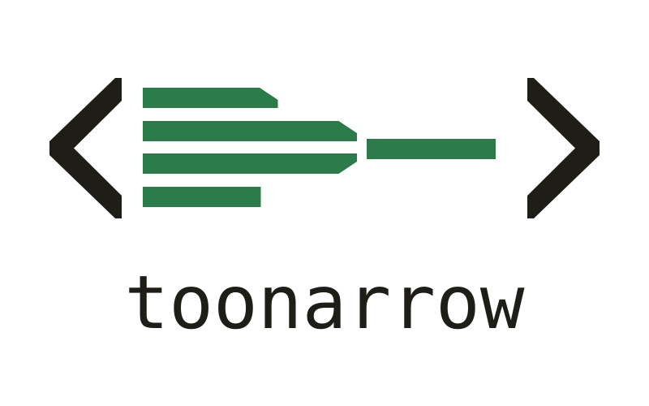

<p align="center">
  <picture>
    <source media="(prefers-color-scheme: dark)" srcset="assets/logo/logo-transparent-dark.svg">
    
  </picture>
</p>

# toonarrow

**The open-source, multi-CLI alternative to Fermat's Last Token.**

toonarrow is a local proxy that cuts the tokens your coding agents send, by rewriting their context before it
reaches the provider. It works with **Claude Code, Codex, OpenCode and [Kora](https://kora-ai.download)** (Desktop and CLI), runs entirely on your machine, needs
no account, and is Apache-2.0 licensed.

> *"I have discovered a truly marvelous proof of this, which this margin is too narrow to contain."*
> Pierre de Fermat, in the margin of his *Arithmetica*.
>
> Your context window is the margin. toonarrow makes the proof fit.

## Why

Coding agents resend the whole conversation on every turn: the system prompt, every tool definition, every file
they read and every command output. Most of it is noise the model does not need verbatim, and you pay for it again on
every request.

Measured on real sessions:

| What | Before | After |
|---|---:|---:|
| OpenCode system prompt with 688 installed skills (first request, gpt-6-luna) | 85,436 input tokens | 25,559 (-70%) |
| Codex skill listing with 519 skills (every session start, lossless) | 39,367 chars | 17,775 (-55%) |
| Output tokens of the main agent with the short-answer rule (Claude Code, Haiku, 2 paired runs) | 2,933 / 2,278 | 1,617 / 1,748 |
| Shell outputs from a real TypeScript monorepo (`git log`, `grep`, `tsc`, `ls -la`, ...) | 100% | 56% |

Over a whole working history the shell rules matter less than the table suggests: most of what agents read is file
content (`cat`, `sed -n`, `Read`), which toonarrow passes through untouched. On the author's last 60 days
(`toonarrow estimate`, every tool result counted once) they removed 2.0% of Claude Code's tool-result tokens, 2.3% of
Codex's, 8.3% of OpenCode's and 4.2% of Kora's. The large, repeated savings come from the skill listings, the
short-answer rule and, on Claude Code, the file tools. Run `toonarrow estimate` to get the numbers for your own
sessions before routing any traffic through it.

## What it does

- **Compresses shell output.** Per-command rules for `ls -l`, `git log/status`, `grep`/`rg`, `find`/`fd`, `pytest`,
  `vitest`/`jest`, `tsc`, `go test`, `cargo`, `npm`/`pip install`, `make`, applied only where the command that
  produced the output is certain: a simple command, the last step of `cd dir && …`, or the head of a pipe whose
  other stages only select lines (`| head`, `| grep pattern`). Codex's code-mode scripts are read the same way,
  one result per command, including the output of a command still running (`write_stdin`). Every compressed
  output tells the model how to get the raw one (`| cat`).
- **Compacts skill listings.** Codex's listing is regrouped by skill root without losing a path (always on).
  With `"skills": true`, the skills you actually use keep their description in every client's listing and the
  rest are listed by name, still loading on demand; `toonarrow skills --write` ranks them from your local history.
- **Replaces file tools.** An MCP server with `Search` (several files per call, folded grep results, tree-sitter
  outlines) and `Edit` (atomic batched edits with a read-gate): on by default with `toonarrow claude`, opt-in with
  `--toonarrow-tools` for OpenCode and Codex.
- **Keeps answers short.** A short-answer rule appended to the main agent's instructions (on Codex, after your own
  `developer_instructions`, never instead of them).
- **Keeps OpenAI's incremental turns.** Codex, OpenCode and Kora talk to the OpenAI Responses API over a WebSocket
  that sends only the new items of each turn; toonarrow relays it and rewrites each turn like an HTTP request.
- **Shows what it saved.** A local dashboard and `toonarrow stats`, in tokens, per day, session, model and client;
  `toonarrow estimate` replays your local history offline.

### What each client gets

| | Claude Code | Codex | OpenCode | Kora Desktop / CLI |
|---|---|---|---|---|
| Shell output rules | `Bash` | code-mode `exec`, `exec_command`, `write_stdin` | `bash`/`shell` | `executeCommand` |
| Search result rewrite | - | - | `grep` | `searchCode` |
| Skill listing | - | regrouped (lossless), descriptions with `"skills": true` | with `"skills": true` | with `"skills": true` |
| File tools (`Search`, `Edit`) | on (`toonarrow claude`) | `--toonarrow-tools` | `--toonarrow-tools` | - |
| Short-answer rule | on | on | on | - |
| Transport | HTTP | Responses WebSocket or HTTP | HTTP, Responses WebSocket with an OpenAI sign-in | HTTP, Responses WebSocket with the OpenAI provider |

### Guarantees

- **Your prompt cache survives.** Every rewrite is a pure, deterministic and idempotent function of the block it
  touches: the same history produces the same bytes on every request.
- **toonarrow is never a dependency.** When it is not running, your agents run exactly as if it were not installed.
- **Nothing leaves your machine** except the requests your agents were already sending. No account, no telemetry.

## toonarrow and Fermat's Last Token

Fermat's Last Token showed that a local proxy plus better file tools can cut an agent's bill. toonarrow takes the
same idea to every coding agent, in the open.

| | toonarrow | Fermat's Last Token |
|---|---|---|
| Source | Open source (Apache-2.0) | Proprietary |
| Account | None | Required |
| Clients | Claude Code, Codex, OpenCode, Kora Desktop and CLI | Claude Code |
| Dashboard | Local, in tokens | Cloud |

*Comparison based on public information as of October 2026. toonarrow is not affiliated with or endorsed by
Quotient Labs; Fermat's Last Token is their product and trademark.*

## Install

Requirements: macOS or Linux (with a systemd user session), Node.js >= 24.

```bash
npm install -g toonarrow
toonarrow install
```

From source:

```bash
git clone https://github.com/andsigno82/toonarrow.git
cd toonarrow
npm install
node src/cli.ts install
```

`install` starts the proxy as a background service on `127.0.0.1:48700` (launchd on macOS, `systemd --user` on
Linux), adds the `toonarrow` command to `~/.local/bin`, and puts small shims for `claude`, `codex`, `opencode` and
`kora` first in your PATH (a marked block in `~/.zshrc`, or on Linux in the rc file of your login shell: `~/.zshrc`,
`~/.bashrc`, otherwise `~/.profile`). Without a systemd user session (containers, WSL without systemd), run
`toonarrow serve` in the background yourself. Open a new shell and keep typing `claude`, `codex`, `opencode` or `kora` as usual: toonarrow attaches
by itself.

## Use

```bash
toonarrow estimate --days 30  # what it would save on your local history, before routing traffic
toonarrow status              # is the proxy running?
toonarrow stats --days 7      # tokens per model, session, client or day
toonarrow dashboard           # open http://127.0.0.1:48700/_toonarrow/
toonarrow skills --write      # keep descriptions only for the skills you use
```

Run a client explicitly through toonarrow, with options:

```bash
toonarrow claude [args]                  # Search/Edit tools, native file tools redirected
toonarrow opencode --toonarrow-tools     # also swap OpenCode's native file tools
toonarrow codex --toonarrow-tools        # also offer Search/Edit to Codex
toonarrow codex --toonarrow-no-brief     # without the short-answer rule
```

### Clients started outside a shell

The shims work wherever a shell reads your rc file. IDE extensions (Claude Code or Codex in VS Code), desktop apps,
cron jobs and scripts started by other programs run the client directly, so they need the proxy address in their own
configuration. `toonarrow env <client>` prints the exact lines for your port:

| Client | Where | What |
|---|---|---|
| Claude Code (CLI and IDE extension) | `"env"` in `~/.claude/settings.json` | `"ANTHROPIC_BASE_URL": "http://127.0.0.1:48700/anthropic"` |
| Codex (CLI and IDE extension) | `~/.codex/config.toml`, user level | `openai_base_url = "http://127.0.0.1:48700/chatgpt"` with ChatGPT sign-in, `".../openai/v1"` with an API key |
| OpenCode | `provider.<id>.options.baseURL` in `opencode.json` | `http://127.0.0.1:48700/anthropic/v1`, `.../openai/v1` with an OpenAI API key, `.../chatgpt` with ChatGPT sign-in |
| Kora CLI | environment | `KORA_LLM_PROXY=http://127.0.0.1:48700` |
| Kora Desktop | *Settings > Smart Token Engine > Context proxy* | see [Kora](#kora) |

Unlike the shims, these settings are static: while toonarrow is not running, the client cannot reach its provider
until you start it again (`toonarrow status`; the service starts at login) or remove the setting. Kora Desktop is
the exception: it checks `/_toonarrow/health` before each request and goes direct when toonarrow is down. Clients
configured this way get the proxy's rewrites (shell output, search results, skill listings) but not what the
launchers add: the short-answer rule and the `Search`/`Edit` tools.

### Codex

Keep typing `codex` (or `codex resume`, `codex exec`): the shim points Codex's built-in `openai` provider at the
proxy with `openai_base_url`, Codex's documented setting for an LLM proxy. Nothing in `~/.codex/config.toml`
changes, and sessions stay recorded under the `openai` provider, so a session started through toonarrow resumes
in plain `codex` or the IDE extension and the other way round.

- **Sign-in.** ChatGPT sign-in and API keys both work: the proxy target follows `auth_mode` in
  `~/.codex/auth.json` (only that field is read).
- **WebSocket.** Codex keeps its Responses WebSocket: each turn sends only its new items, and toonarrow rewrites
  them on the way.
- **Your instructions.** The short-answer rule is appended to the `developer_instructions` of your profile, project
  or user config; if that value is not a plain TOML string, the rule is left out rather than replacing it.
- **File tools.** Codex lists MCP tools to the model only on demand, and for plain file reads `Search` returns as
  many bytes as `cat`, so the toonarrow MCP server is added only with `--toonarrow-tools`.
- **Without the shim.** For the IDE extension and other non-shell starts, see
  [Clients started outside a shell](#clients-started-outside-a-shell).

### Kora

[Kora](https://kora-ai.download) is a free, native AI workspace for macOS
([documentation](https://docs.kora-ai.download)). toonarrow works with both Kora Desktop and Kora CLI, and trims what
weighs most in a Kora request: the `## Available Skills` listing, which with hundreds of installed skills is most of
the prompt, and the output of `executeCommand`.

- **Kora Desktop.** Turn on *Settings > Smart Token Engine > Context proxy*; the default address
  `http://127.0.0.1:48700` is toonarrow's, and a badge shows whether it is reachable. Before sending a request, Kora
  checks `/_toonarrow/health` and goes straight to the provider when toonarrow is not running, so the switch can stay
  on. It covers the inference requests of the Kora, ByteDance, Kimi Code, custom and OpenAI (ChatGPT sign-in)
  providers; model lists and sign-in always go direct.
- **[Kora CLI](https://kora-ai.download/cli).** Nothing to configure: keep typing `kora`. When toonarrow is running, the `kora` shim sets
  `KORA_LLM_PROXY`, the Kora counterpart of `ANTHROPIC_BASE_URL`; when it is not, `kora` starts unchanged.

The dashboard and `toonarrow stats` show Kora Desktop and Kora CLI as separate clients (`Kora` and `Kora-CLI`).

### Configuration

`~/.toonarrow/config.json`:

```json
{
  "port": 48700,
  "capture": "off",
  "compress": { "bash": true, "skills": false, "keepSkills": [] }
}
```

### Uninstall

```bash
toonarrow uninstall
```

Removes the service, the command, the shims and the shell rc block. Your data stays in `~/.toonarrow`.

## How it works

```text
claude / codex / opencode / kora
        |  shim: is toonarrow running?  no -> run the client unchanged
        v
127.0.0.1:48700  ->  rewrite context  ->  provider API (HTTP, or the Responses WebSocket)
        |              (shell output, search results, skills)
        +-- tee response -> token usage -> ~/.toonarrow/usage
```

Details, invariants and the verified wire format of each client: [documentation/architecture.md](documentation/architecture.md).

## Contributing

Issues and pull requests are welcome. Before you send one:

```bash
npm test
npm run typecheck
```

Every new transformation needs a test that applies it twice and gets the same bytes, and no change may make a client
depend on toonarrow being up.

## License

[Apache-2.0](LICENSE)
